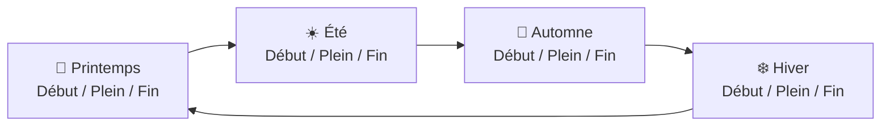

# 🧭 Guide de Survie des Joueurs — PaperSeasons

Bienvenue sur le serveur ! Le monde est désormais soumis au rythme des **saisons**, à une **physique thermique réaliste**, à un **cycle jour/nuit dynamique** et à un **calendrier agricole biologique**.

Ce guide vous donne toutes les clés pour survivre, prospérer et tirer parti de chaque saison !

---

## 📅 1. Le Rythme de l'Année (Les 4 Saisons & 12 Phases)

Une année complète dure **36 jours Minecraft** (soit environ 12 heures de jeu réel). Chaque saison dure **9 jours** et traverse **3 phases progressives** :

* 🌸 **Printemps (Jours 1 à 9) :**
  * Fonte des neiges, pluies fertiles, feuillage vert tendre bourgeonnant.
  * Saison idéale pour planter et faire reproduire vos animaux.
* ☀️ **Été (Jours 10 à 18) :**
  * Soleil éclatant, chaleur caniculaire, herbes jaunies par la sécheresse.
  * **Les journées sont ~35% plus longues** et les nuits plus courtes.
* 🍁 **Automne (Jours 19 à 27) :**
  * Les arbres prennent une teinte orange rouille flamboyante puis brun cuivré.
  * Pluies fraîches, brumes et saison des champignons et des citrouilles.
* ❄️ **Hiver (Jours 28 à 36) :**
  * Chutes de neige, lacs gelés, blizzards et froid mordant.
  * **Les nuits sont ~35% plus longues** et les journées courtes.

---

## 🌡️ 2. La Thermorégulation : Maîtriser sa Température

Votre corps réagit constamment à votre environnement. Vous pouvez consulter votre température corporelle en direct en bas de votre écran ou en tapant `/season status`.

| État | Température | Effets en jeu |
| :--- | :--- | :--- |
| 🥶 **Hypothermie (Gel)** | **< 0 °C** | Écran givré, mouvements ralentis, cœur gelé et dégâts continus de froid. |
| 😊 **Température Idéale** | **15 °C à 25 °C** | Aucun malus, régénération optimale. |
| 🔥 **Coup de Chaud (Canicule)** | **> 38 °C** | Épuisement physique accéléré, soif/faim qui fond à toute vitesse. |

### 🛡️ Comment réguler sa température ?

1. **🏠 L'Isolation des Bâtiments & Grottes (Le Réflexe Vital) :**
   * Être sous un toit ou dans une grotte **absorbe 70% du froid hivernal** et **80% de la chaleur écrasante du soleil d'été**.
2. **🧥 Le Choix des Armures :**
   * **L'armure en cuir :** Votre meilleur allié l'hiver ! Chaque pièce apporte **+2.5 °C** (soit **+10 °C en armure complète**).
   * **Les armures métalliques (Fer, Diamant) :** Conduisent le froid (**-1.0 °C** par pièce). En plein blizzard d'hiver, retirez votre plastron de fer si vous n'êtes pas au chaud !
   * **L'armure en Netherite :** Isole grâce à sa chaleur volcanique (**+1.5 °C** par pièce).
3. **🔥 Les Sources de Chaleur :**
   * Porter une torche, une lanterne, un bâton de blaze ou un seau de lave en main (principale ou secondaire) vous réchauffe.
   * Vous tenir près d'un feu de camp, d'un fourneau allumé ou de torches posées réchauffe instantanément votre corps.
4. **☀️ L'Heure de la Journée :**
   * Le soleil chauffe à son maximum à midi (au zénith).
   * La nuit est la période la plus froide : évitez de voyager de nuit en hiver sans équipement adapté.

---

## 💧 3. L'Eau & la Pluie : Attention à la Mouillure !

Votre état d'humidité varie de **0% (sec)** à **100% (trempé)**. L'icône `💧` apparaît dans votre statut quand vous êtes mouillé.

* **Comment devient-on mouillé ?**
  * Nager ou traverser une rivière $\rightarrow$ **100% d'humidité immédiate**.
  * Marcher sous la pluie sans casque $\rightarrow$ **+15% par cycle** (porter un casque réduit ce gain à **+5%**).
* **Les effets de la mouillure :**
  * ❄️ **En Hiver / Automne :** Être trempé est mortel. L'humidité vous inflige un refroidissement violent pouvant atteindre **-8.0 °C** !
  * ☀️ **En Plein Été (> 32 °C) :** Sauter dans l'eau permet de se rafraîchir efficacement et apporte un soulagement salvateur jusqu'à **-6.0 °C**.
* **Comment sécher rapidement ?**
  * Approchez-vous d'un feu de camp, d'un fourneau ou d'une torche murale : vous sécherez **5 fois plus vite** qu'à l'air libre !

---

## 🌬️ 4. Le Vent d'Altitude ("Wind Chill")

* Dès que vous montez en haute montagne (**au-dessus de Y = 95**) à ciel ouvert, le vent souffle violemment.
* Ce vent glacial peut faire chuter votre température de **jusqu'à -6.0 °C**, et **-12.0 °C pendant les orages et tempêtes de neige** !
* *Conseil :* Si vous partez miner en haute altitude, construisez des abris de refuge ou progressez à l'intérieur des galeries souterraines.

---

## 🌾 5. Le Calendrier des Récoltes & Serres d'Hiver

La nature n'accepte plus n'importe quelle culture à n'importe quelle saison :

| Saison | Cultures Favorisées | Cultures Pénalisées |
| :--- | :--- | :--- |
| **🌸 Printemps** | **+35% à +40%** : Blé, Carottes, Patates, Betteraves, Baies sucrées, Arbres | Aucune |
| **☀️ Été** | **+40%** : Pastèques, Canne à sucre, Cacao, Bambou, Cactus | **-35%** : Patates & Betteraves (hors abri) |
| **🍁 Automne** | **+40%** : Citrouilles, Champignons, Baies, Légumes-racines | **-50%** : Cultures tropicales & canne à sucre |
| **❄️ Hiver** | **Aucune culture ne pousse en extérieur (Gel total)** | Tout gèle dehors |

### 🏡 Comment faire une Serre d'Hiver ?
Pour nourrir votre colonie pendant la saison froide, bâtissez une serre fermée :
1. **Plafond en Verre :** Placez des blocs de verre ou des vitres au-dessus de vos plantations (entre 1 et 12 blocs au-dessus de la terre).
2. **Chauffage Actif :** Installez des torches, des lanternes ou des feux de camp pour maintenir un niveau de lumière de bloc d'au moins **12** sur vos pousses.
3. *Sous ces deux conditions, vos récoltes continueront de pousser tout l'hiver !*

---

## 🐄 6. Élevage & Pêche Saisonnière

* 🐣 **Le Printemps des Éleveurs :**
  * Les naissances d'animaux au printemps ont **25% de chances de donner des jumeaux** !
  * Vous gagnez le **double d'expérience** lors de la reproduction printanière.
* 🥶 **L'Hiver des Bêtes :**
  * Les bêtes qui tentent de se reproduire en extérieur sous la neige ont **50% de risques d'échouer**.
  * Construisez des étables ou granges couvertes et chauffées pour abriter vos troupeaux !
* 🎣 **Pêche :**
  * Les poissons mordent **25% plus vite** au printemps et en automne.
  * En hiver sous la glace, le temps d'attente est allongé de **35%**.

---

## 🍲 7. Plats Chauds & Boissons Rafraîchissantes

Manger et boire permet de modifier directement votre température corporelle :

* 🍵 **Pour se Réchauffer (Automne & Hiver) :**
  * Manger une soupe ou un ragoût chaud (*Ragoût de champignons, Ragoût de lapin, Ragoût suspect, Soupe de betteraves*) vous octroie un **buff réchauffant de +4.0 °C pendant 90 secondes**.
  * Les bières et alcools artisanaux brassés avec **BreweryX** apportent également une chaleur bienfaitrice contre le blizzard !
* 🍉 **Pour se Rafraîchir (Plein Été ou Chaleur > 30 °C) :**
  * Consommer des tranches de pastèque, des baies fraîches, du lait ou des potions fraîches confère un **buff rafraîchissant de -4.0 °C pendant 60 secondes** et soulage l'épuisement.

---

## 🎮 8. Commandes Disponibles

* `/season` ou `/season status` :
  * Affiche la saison en cours, la sous-saison, le jour de l'année et l'heure solaire.
  * Fournit votre bilan thermique complet : température exacte, humidité (`💧`), vent (`🌬️`) et buffs actifs.

---

## 🎒 9. La Trousse de Survie Recommandée

* **En Hiver :**
  * 1 set complet d'armure en cuir dans le sac à dos.
  * Des feux de camp et du charbon pour vous réchauffer rapidement.
  * 3 à 4 soupes de champignons ou ragoûts de lapin avant chaque expédition.
  * Une torche tenue en main secondaire.
* **En Été :**
  * 1 seau d'eau pour vous mouiller si vous traversez un biome aride.
  * Des tranches de pastèque pour contrer les coups de chaleur.
  * Une armure légère lors des longues marches en plein soleil.
