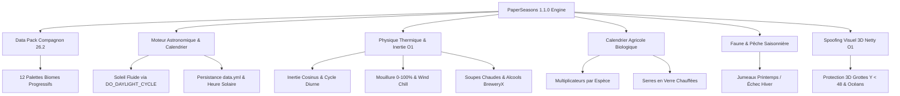
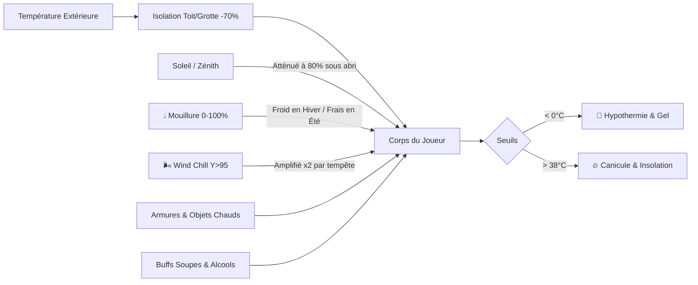

# 🍂 PaperSeasons v1.1.0 — Realism & Ecosystem Update

**PaperSeasons** est un système hybride complet composé d’un **Plugin PaperMC haute performance** (logique $O(1)$ stricte) et d’un **Data Pack compagnon** (`paper_seasons_dp`), conçu sur mesure pour tourner sur un **Raspberry Pi 5 (ARM64)** derrière un tunnel réseau **Playit.gg**, tout en cohabitant harmonieusement avec **Paper 26.2**, **Terralith**, **Incendium** et **BreweryX**.

---

## 🌟 Vue d'ensemble de l'Architecture



---

## 🎨 1. Les 12 Sous-Saisons Visuelles (Zéro Mod requis)

Le Data Pack compagnon et le système de **spoofing réseau Netty autonome** métamorphosent le rendu du monde côté client sans nécessiter de mod (Fabric/Forge) ni de resource pack sur les clients :

| Saison | Sous-Saison (`Phase`) | Teinte du Feuillage | Teinte de l'Herbe | Ambiance & Effets |
| :--- | :--- | :--- | :--- | :--- |
| **🌸 Printemps** | `SPRING_EARLY`<br>`SPRING_MID`<br>`SPRING_LATE` | Vert tendre pâle (`#76C454`)<br>Vert prairies fleuries (`#59C93C`)<br>Vert dense pré-été (`#4EB530`) | Vert pâle naissant (`#8DD968`)<br>Vert vif éclatant (`#77D651`)<br>Vert riche d'été (`#6CC443`) | Fonte progressive des neiges, bourgeons, averses fertiles |
| **☀️ Été** | `SUMMER_EARLY`<br>`SUMMER_MID`<br>`SUMMER_LATE` | Vert éclatant vif (`#48B518`)<br>Vert chaud doré (`#5DB31E`)<br>Vert sec jauni (`#7AA62B`) | Vert chaud lumineux (`#8EB94E`)<br>Ocre ensoleillé (`#A1BF45`)<br>Herbe roussie sécheresse (`#B3BD48`) | Soleil ardent, ciel radieux, sécheresse estivale |
| **🍁 Automne** | `AUTUMN_EARLY`<br>`AUTUMN_MID`<br>`AUTUMN_LATE` | Jaune doré bouleau (`#B0981D`)<br>Orange érable flamboyant (`#D45B12`)<br>Brun feuilles mortes (`#7A4928`) | Vert ocre automnal (`#9CA832`)<br>Ocre roux (`#C48B28`)<br>Brun terreux pré-hiver (`#8F6E35`) | Chute des feuilles, brumes denses, pluies fraîches |
| **❄️ Hiver** | `WINTER_EARLY`<br>`WINTER_MID`<br>`WINTER_LATE` | Gel précoce gris-brun (`#5A543A`)<br>Grand froid bleuté (`#4A4C59`)<br>Fonte tardive gris-vert (`#5C6250`) | Vert givré froid (`#7A8A7A`)<br>Herbe blanche gelée (`#8C979E`)<br>Herbe détrempée boueuse (`#758268`) | Chutes de neige, lacs gelés, blizzards |

### 🛡️ Protection 3D Intégrale de Terralith & Incendium
- **Zéro corruption de fichiers :** Aucun `world.setBiome()` n'est écrit sur le disque. Les fichiers de régions de votre monde restent 100% vanilla/Terralith purs.
- **Protection des Grottes ($Y < 48$) :** Les *Lush Caves*, *Dripstone Caves*, *Deep Dark* et grottes custom de **Terralith** conservent leurs biomes natifs et leurs couleurs végétales souterraines.
- **Biomes Spéciaux préservés :** Océans, rivières profondes, mangroves, déserts arides, ainsi que l'intégralité du Nether (**Incendium**) et de l'End.

---

## ☀️ 2. Moteur Astronomique & Calendrier Solaire

- **Soleil 100% Fluide (Zéro lag Playit.gg) :** N'utilise **jamais** `setFullTime()` (ce qui briserait le vieillissement des fûts de **BreweryX** et ferait saccader le soleil à distance). Le cycle jour/nuit est piloté par fractionnement de la gamerule vanilla `GameRule.DO_DAYLIGHT_CYCLE`.
- **Journées Dynamiques Réalistes :**
  - **Été :** Journées ~35% plus longues, nuits courtes et douces.
  - **Hiver :** Journées courtes, nuits ~35% plus longues et glaciales.
- **Heure Solaire & Persistance :** Détection automatique du passage des jours, stockage synchrone dans `plugins/PaperSeasons/data.yml` et horloge solaire affichée (ex: `Jour 09h49`).

---

## 🌡️ 3. Thermorégulation & Survie Réaliste ($O(1)$)

Calculée toutes les 40 ticks (2 secondes) par joueur en pur $O(1)$ sans aucun parcours de blocs.

### Formule Thermique :
$$\text{Temp} = \text{BiomeBase} + \text{InertieCosinus} + \text{CycleDiurne} - \text{Altitude} + \text{Armure} + \text{Main} + \text{BlocsChauds} - \text{Vent} \pm \text{Mouillure} + \text{Buffs}$$



### Facteurs Thermiques Clés :
1. **Inertie Annuelle par Cosinus :** La transition entre sous-saisons est une courbe continue $\frac{1 - \cos(\text{progression} \times \pi)}{2}$ : aucun à-coup de température au changement de jour.
2. **Cycle Diurne / Nocturne :** Le soleil réchauffe jusqu'à son pic à midi (`6000t`), et la nuit refroidit l'atmosphère (`18000t`). Cet effet est réduit de **80%** à l'intérieur.
3. **💧 Mouillure ("Wetness" de 0 à 100%) :**
   - Traverser l'eau (`100%`) ou marcher sous la pluie (`+15%`, ou `+5%` avec un casque).
   - **En Hiver/Automne :** Pénalité glaciale jusqu'à **`-8.0 °C`** !
   - **En Plein Été (> 32 °C) :** Soulagement rafraîchissant bienvenu jusqu'à **`-6.0 °C`** !
   - **Séchage Rapide :** Séchage de `-25%` par cycle près d'un feu ou d'une torche (`BlockLight >= 12`).
4. **🌬️ Refroidissement Éolien ("Wind Chill") :**
   - Au-dessus de **$Y = 95$** à ciel ouvert, le vent glacial accélère le refroidissement (jusqu'à `-6 °C`), doublé en cas de tempête ou blizzard (**`-12 °C`**).
5. **🏠 Isolation des Bâtiments & Grottes :**
   - Être sous un toit (`LightFromSky < 10`) réduit de **70%** l'impact de la météo et du climat extérieur.
6. **🧥 Équipements & Armures :**
   - **Cuir :** Isolant parfait contre le grand froid (+2.5 °C par pièce, soit **+10 °C en armure complète**).
   - **Fer / Diamant :** Conduisent le froid métallique (-1.0 °C par pièce).
   - **Netherite :** Chaleur volcanique (+1.5 °C par pièce).
   - **Objets chauds en main :** Torches, lanternes, feux de camp, bâtons de blaze, seaux de lave.

---

## 🌾 4. Calendrier Agricole Biologique & Serres

Chaque espèce de culture possède ses préférences saisonnières :

```
🌸 PRINTEMPS (+35% à +40%) : Blé, Carottes, Patates, Betteraves, Baies, Pousses d'arbres
☀️ ÉTÉ (+40%)              : Pastèques, Canne à sucre, Cacao, Bambou, Cactus
   ⚠️ Pénalité Été (-35%)   : Patates & Betteraves hors abri (souffrent de la chaleur)
🍁 AUTOMNE (+40%)          : Citrouilles, Champignons, Baies sucrées, Racines
   ⚠️ Pénalité Automne (-50%): Cultures tropicales & céréales d'été ralenties
❄️ HIVER                   : Gel complet des cultures en extérieur
```

### 🏡 Fonctionnement des Serres en Hiver :
Pour cultiver en plein hiver, les plantes doivent être abritées sous une **serre** :
- **Plafond en Verre** (verre blanc ou vitres teintées) situé entre **1 et 12 blocs** au-dessus de la plantation.
- **Chauffage Actif :** Une source de lumière chaude assurant une intensité $\text{BlockLight} \ge 12$ (torches, feux de camp, lanternes).

---

## 🐄 5. Faune Élevage & Pêche Saisonnière

- 🐣 **Fertilité du Printemps :** Les animaux accouplés au printemps ont **25% de chances de donner naissance à des jumeaux** et rapportent le double d'XP.
- 🥶 **Mortalité Hivernale :** Les reproductions tentées dehors sous la neige ont **50% de chances d'échouer**. Rentrez vos troupeaux dans des granges couvertes et chauffées !
- 🎣 **Pêche Réactive :**
  - **Printemps & Automne :** Les poissons sont actifs, temps d'attente réduit de **25%**.
  - **Hiver :** Morsures ralenties de **35%** sous la surface glacée.

---

## 🍲 6. Nutrition & Synergie Brasserie (BreweryX)

- 🍵 **Soupes & Plats Chauds (Automne & Hiver) :**
  - Consommer un *ragoût de champignons, de lapin, un ragoût suspect* ou une *soupe de betteraves* confère un **buff réchauffant de +4.0 °C pendant 90 secondes**.
  - Boire un alcool ou une bière brassée via **BreweryX** procure une protection supplémentaire contre le gel.
- 🍉 **Boissons Fraîches & Fruits d'Été (Chaleur $\ge 30^\circ\text{C}$) :**
  - Consommer une *potion, un seau de lait, une pastèque* ou des *baies fraîches* procure un **buff rafraîchissant de -4.0 °C pendant 60 secondes** et réduit l'épuisement physique.

---

## 🎮 7. Commandes

| Commande | Rôle | Permission |
| :--- | :--- | :--- |
| `/season` ou `/season status` | Diagnostic complet : saison, sous-saison, jour, heure solaire, température exacte, badges d'humidité `💧` et de vent `🌬️`, état des buffs. | Accessible à tous |
| `/season nextday` | Fait avancer le calendrier d'un jour immédiatement. | `paperseasons.admin` (ou OP) |
| `/season next` | Bascule immédiatement à la saison suivante. | `paperseasons.admin` (ou OP) |
| `/season set <SAISON>` | Définit la saison (`SPRING`, `SUMMER`, `AUTUMN`, `WINTER`) et réinitialise au Jour 1. | `paperseasons.admin` (ou OP) |
| `/season reload` | Recharge à chaud `config.yml`, reconstruit tous les caches $O(1)$ et rafraîchit les paquets biomes de tous les joueurs. | `paperseasons.admin` (ou OP) |

---

## ⚙️ Structure des Fichiers du Projet

```
e:/minecraft/PaperSeasons/
├── build.gradle.kts                   # Buildscript Gradle Java 21
├── paper_seasons_dp/                  # Data Pack compagnon (12 sous-saisons)
│   ├── pack.mcmeta                    # Formats 48 (1.21.1) et 107 (26.2)
│   ├── data/paperseasons/worldgen/biome/
│   └── overlay_26_2/data/paperseasons/worldgen/biome/
└── src/main/
    ├── resources/
    │   ├── paper-plugin.yml           # Déclaration Paper Plugin 1.1.0
    │   └── config.yml                 # Configuration complète documentée
    └── java/fr/alexuslab/paperseasons/
        ├── PaperSeasonsPlugin.java    # Cycle de vie et enregistrements
        ├── SeasonManager.java         # Calendrier, sous-saisons, DO_DAYLIGHT_CYCLE
        ├── SeasonConfigCache.java     # Caches immuables EnumMap O(1)
        ├── TemperatureTask.java       # Thermorégulation O(1), wetness, wind chill
        ├── SeasonEnvironmentListener.java # Événements cultures, élevage, pêche, nourriture
        ├── BiomePacketSpoofer.java    # Pipeline Netty 3D autonome (sans mod)
        └── SeasonCommand.java         # Interface de commande /season
```

---

## 🚀 Performance Garantie sur Raspberry Pi 5

- **Budget Serveur Strict :** $< 0.01\text{ ms}$ MSPT par joueur (testé à 10 000 évaluations complètes en $\approx 5\text{ ms}$).
- **Zéro Garbage Collection intempestive :** Toutes les tables sont pré-allouées au démarrage dans des `EnumMap` primitives.
- **Réseau Économe :** L'ActionBar ne transmet un paquet que si la température varie d'au moins $0.5^\circ\text{C}$, garantissant une fluidité parfaite sur le tunnel **Playit.gg**.
